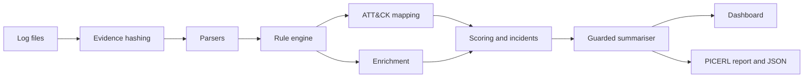

# TriageDesk

[](https://github.com/Syed-Affan-Hayat/triagedesk/actions/workflows/ci.yml)

**Live demo:** <https://triagedesk-f5tt.onrender.com/> (the free instance sleeps when idle; the first load can take about a minute)

Evidence-grounded triage of SSH and web server logs. TriageDesk parses raw logs, runs readable
detection rules mapped to MITRE ATT&CK, enriches suspicious addresses with threat intelligence,
prioritises alerts with a transparent score, and writes an incident report in the PICERL format.
Optional AI summaries must cite the exact log lines behind every claim, and the summariser is
defended against prompt injection planted in the logs it reads.

Capstone project for the Cybersecurity Analyst Program by Edversity (2026).

## The problem

Security operations teams receive more alerts than they can review. Vectra AI's 2026 State of
Threat Detection and Response report found an average of 2,992 alerts per day, with 63% left
unaddressed, and 44% of defenders struggling to prioritise real threats
([press release coverage](https://www.channelinsider.com/security/vectra-ai-sec-trends-research/)).
Small organisations without a commercial SIEM do this first pass by hand, reading raw logs line by
line. Teams that add AI assistants face a newer risk: log content is written by whoever generated
the traffic, so an attacker can plant instructions aimed at the model (OWASP LLM01, MITRE ATLAS
AML.T0051.001).

## What it does

| Stage | Function |
|---|---|
| Evidence | SHA-256 hash of every file on receipt, recorded in the report |
| Parsing | OpenSSH auth logs (classic syslog and RFC 3339) and Combined Log Format access logs into one schema |
| Detection | 10 YAML rules of four types (match, threshold, distinct, sequence) |
| Mapping | Each rule mapped to MITRE ATT&CK or MITRE ATLAS techniques |
| Enrichment | AbuseIPDB reputation, or an offline mock for the bundled samples |
| Scoring | 0 to 100 score with a visible reason for every point, priorities P1 to P4 |
| Summaries | Offline template, or a language model behind guardrails |
| Reporting | Markdown report (PICERL) and JSON export |



## Quick start

Requires Python 3.10 or later.

```bash
git clone https://github.com/Syed-Affan-Hayat/triagedesk.git
cd triagedesk
python3 -m venv .venv
source .venv/bin/activate          # Windows: .venv\Scripts\activate
pip install -r requirements-dev.txt
cp .env.example .env               # optional; defaults work without it

triagedesk rules                   # list and validate the detection rules
triagedesk analyze data/samples/auth.log data/samples/access.log --offline
streamlit run app/streamlit_app.py # dashboard at http://localhost:8501
```

Write a report:

```bash
triagedesk analyze data/samples/auth.log data/samples/access.log \
    --report reports/case.md --json reports/case.json
```

## Configuration

All settings are environment variables; see `.env.example`.

| Variable | Default | Purpose |
|---|---|---|
| `TRIAGEDESK_ENRICHMENT_MODE` | `mock` | `mock`, `abuseipdb` or `off` |
| `ABUSEIPDB_API_KEY` | empty | Required for `abuseipdb` mode |
| `LLM_BASE_URL`, `LLM_API_KEY`, `LLM_MODEL` | empty | OpenAI-compatible endpoint for AI summaries; all three enable the model |
| `TRIAGEDESK_MAX_UPLOAD_MB` | `10` | Maximum size per file |
| `TRIAGEDESK_LOG_TIMEZONE` | `UTC` | Time zone for syslog lines without an offset |

## Detection rules

| Rule | Type | Severity | Technique | Detects |
|---|---|---|---|---|
| TD-SSH-001 | threshold | high | T1110.001 | 5 or more failed SSH logins from one address in 5 minutes |
| TD-SSH-002 | distinct | high | T1110.003 | 4 or more user names tried from one address in 15 minutes |
| TD-SSH-003 | sequence | critical | T1110.001, T1078 | A successful login after 5 or more failures |
| TD-SSH-004 | match | high | T1078.003 | Direct SSH login as root |
| TD-WEB-001 | match | high | T1190 | SQL injection syntax in a request |
| TD-WEB-002 | match | medium | T1190 | Cross-site scripting payloads |
| TD-WEB-003 | match | high | T1190, T1083 | Path traversal and sensitive file probes |
| TD-WEB-004 | match | low | T1595.002 | Known scanner user agents |
| TD-WEB-005 | threshold | medium | T1595.003 | 20 or more 404 responses to one address in a minute |
| TD-AI-001 | match | medium | AML.T0051.001 | Prompt injection text aimed at AI tools |

Rules live in `src/triagedesk/detection/rules/`. Each file documents its known false positives and
response steps. The format is inspired by [Sigma](https://github.com/SigmaHQ/sigma) but is smaller
and not Sigma-compatible.

## Security design

- **Integrity:** evidence is hashed with SHA-256 before parsing; the report lists every hash.
- **Untrusted input:** upload size and line limits, tolerant decoding, line length limits.
- **Prompt injection:** log text is isolated in an escaped evidence block, the system prompt
  forbids following it, replies must be JSON citing real event IDs, unsupported findings are
  removed, and the model cannot downgrade an incident below what the rules found.
- **Output handling:** log lines are shown in code blocks and model text is Markdown-escaped, so
  nothing from a log or a model renders as a link, image or HTML.
- **Secrets:** read from environment variables only; `.env` is excluded from version control.
- **Human in the loop:** containment steps are recommendations that require analyst approval.
- **Container:** runs as an unprivileged user.

## Testing

```bash
pytest        # parsers, rules, scoring, guardrails and the end-to-end pipeline
make lint     # ruff
```

The bundled samples (`scripts/generate_samples.py`) plant six attack scenarios and benign noise,
including a user who mistypes a password twice; the end-to-end test asserts that every scenario is
detected and the benign activity is not.

## Deployment

The live instance runs on Render at <https://triagedesk-f5tt.onrender.com/>. The repository includes
a `Dockerfile` and a Render Blueprint (`render.yaml`). On Render, create a Blueprint from the
repository; the service builds from the Dockerfile and serves the dashboard.
Free instances sleep when idle and take about a minute to wake.

## Project structure

```text
app/                       Streamlit dashboard
data/samples/              Synthetic sample logs
docs/                      Project documentation
scripts/                   Sample data generator
src/triagedesk/
    parsers/               Log parsers
    detection/             Rule engine, ATT&CK catalogue, rules/
    enrichment/            Reputation providers
    ai/                    Summariser and guardrails
    scoring.py             Prioritisation and incident grouping
    pipeline.py            End-to-end analysis
    report.py              Markdown and JSON export
    cli.py                 Command-line interface
tests/                     Test suite
```

## Limitations

- Two log sources (OpenSSH and Combined Log Format). Windows event logs are planned.
- Rules are pattern based; encoded or novel payloads can evade them, and thresholds need tuning
  per environment.
- Prompt injection defences reduce risk but cannot eliminate it; AI summaries are decision
  support and are always shown next to the raw evidence.
- The bundled data is synthetic. Results on it demonstrate behaviour, not real-world accuracy.

## License

MIT. See [LICENSE](LICENSE).

## Author

Syed Affan Hayat, BS Computer Science, Lahore University of Management Sciences (LUMS).
